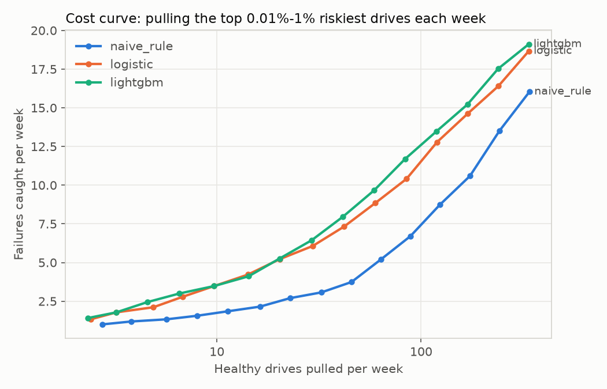

# Halflife

Storage operators lose data and on-call hours when hard drives die without warning, but pulling drives "just in case" wastes hardware and technician time. Halflife gives every drive in a fleet a calibrated chance of failing within 7, 30 and 90 days, so an operator with capacity to replace K drives a week pulls the right K. It explains each pick in plain language, alerts when a drive turns risky, and shows exactly how messy the incoming sensor data was.

Data: [Backblaze Drive Stats](https://www.backblaze.com/cloud-storage/resources/hard-drive-test-data) (daily SMART snapshots), read from Backblaze's public Iceberg table on B2. Halflife is not affiliated with Backblaze. Project page: https://apatha32.github.io/Halflife/

## Architecture

```mermaid
flowchart LR
  B2[(Backblaze Drive Stats<br/>Iceberg on B2)] -->|nightly: newest months,<br/>10% of drives by serial hash| BR[bronze Parquet<br/>year/month]
  UP[/Customer CSV<br/>uploaded in the app/] -->|Supabase Storage| UW[uploads job:<br/>propose mapping,<br/>apply after review]
  UW --> BR2[fleet bronze]
  BR --> CL[clean: canonical schema,<br/>counter rebasing, lifecycle,<br/>quarantine + quality report]
  BR2 --> CL
  CL --> SV[silver Parquet]
  SV --> FT[features: past-only windows,<br/>7/30/90-day labels]
  FT --> GD[gold Parquet]
  GD --> TR[train: naive / logistic / LightGBM,<br/>Platt calibration, drift reference]
  TR --> MD[(models/version)]
  GD --> SC[score: 7/30/90-day risk,<br/>rank, SHAP drivers, drift]
  MD --> SC
  SC -->|service-role upsert| SB[(Supabase Postgres<br/>RLS per fleet, alerts)]
  SB --> SL[Slack webhook]
  SB -->|user session, anon key| WEB[Next.js on Vercel<br/>pull list, drive detail, alerts,<br/>data quality, upload]
```



Two Railway cron services run the same `workers/` Docker image: `halflife nightly` once a day (new Backblaze data, rescoring, alerts, model health) and `halflife uploads` every 10 minutes (customer files). Python workers (uv, DuckDB, Polars, LightGBM, Typer) do the data work on Parquet; only curated outputs (scores, 180-day history for the top 1,000 drives, quality reports, alerts, upload status) reach Supabase. The web app reads with the signed-in user's session, so Postgres row-level security decides what each fleet sees.

## Messy-data fixes (latest full run)

2024-01-01 to 2026-09-30, 10% of drives sampled by serial-number hash (each sampled drive keeps its full history):

| Check | Count |
|---|---|
| Rows in (bronze) | 32,148,944 |
| Rows out (silver) | 32,142,419 |
| Quarantined: capacity reported as 0 or less | 3,312 |
| Quarantined: rows after a drive's first failure (drive "failed" then reappeared) | 3,213 |
| SMART counter resets rebased (counter dropped within a drive) | 4,903 events, 651,521 rows adjusted |
| Distinct schema hashes (set of reported SMART columns changed by month) | 7 |
| Drives: still active / retired or missing / failed | 37,290 / 3,307 / 1,243 |

Rows in always equals rows out plus quarantined, and every quarantined row keeps a reason. A run fails if any column's null rate jumps more than `NULL_RATE_MAX_JUMP` against the previous report. Customer uploads also count values that could not be parsed, per column.

Onboarding the synthetic "Northwind" file (renamed columns, Fahrenheit temperatures, MM/DD/YYYY dates, numbers with thousands separators, two SMART columns missing) through the upload page: the proposed mapping was correct for every field, 712 duplicates (2%) were quarantined and 300 drives were scored at 77% attribute coverage. Column matching also handles smartctl-style names (`Reallocated_Sector_Ct`, `Temperature_Celsius`) and capacity in bytes.

Which SMART attributes are used and why: [docs/decisions/0001-smart-attributes.md](docs/decisions/0001-smart-attributes.md).

## Model results

Labels: the drive fails within 7, 30 or 90 days. Splits by date with 30-day gaps: train 2024-01-01 to 2025-07-01, validate 2025-08-01 to 2026-01-29, test 2026-03-01 to 2026-08-31. Evaluated on weekly (Monday) snapshots of about 37,000 drives; K = 50 drives pulled per week. LightGBM was picked on validation PR-AUC.

| Test period, 30-day label | PR-AUC | Precision@50 | Recall@50 |
|---|---|---|---|
| Naive rule (reallocated or pending sectors > 0) | 0.052 | 7.7% | 10.3% |
| Logistic regression | 0.101 | 14.8% | 19.7% |
| **LightGBM** | **0.105** | **15.9%** | **21.2%** |

At 50 pulls a week, LightGBM catches about twice as many soon-to-fail drives as the naive rule. Each horizon is calibrated on the validation period with Platt scaling (rank-preserving), so risk is a probability:

| Test period, calibrated | PR-AUC | Brier | Expected failures | Observed failures |
|---|---|---|---|---|
| Within 7 days | 0.062 | 0.00025 | 220 | 244 |
| Within 30 days | 0.105 | 0.00100 | 900 | 1,015 |
| Within 90 days | 0.157 | 0.00305 | 1,876 | 2,126 |

The model under-predicts by about 11%, which is reported as is. The three horizons are separate calibrated classifiers kept monotone (7 <= 30 <= 90), a discrete-time stand-in for a survival model. Failures are rare (about 0.1% of drives fail in any 30 days), so most pulls at this budget are still healthy drives; the cost curve shows the trade-off for each weekly pull budget (top 0.01% to 1% of the fleet):



Each nightly run also measures drift (PSI of every feature on the newest day versus training) and backtests the latest fully labeled Monday. It currently shows real drift in power-on hours and age (PSI 0.37) because the 2026 fleet is older than the training data. Full tables: [docs/evaluation.md](docs/evaluation.md).

## Run locally

Requires uv, Node 22, Docker and the Supabase CLI.

```sh
make setup
cp .env.example .env        # fill B2_* with the public read-only values from Backblaze's Iceberg post
supabase start              # local Postgres, Auth and Storage; applies migrations and seed
# put `supabase status` API URL + service_role key into .env (SUPABASE_*)
# and API URL + anon key + DEMO_PASSWORD into web/.env.local (NEXT_PUBLIC_*)

cd workers
uv run --env-file ../.env halflife nightly     # ingest -> clean -> features -> score newest day -> alerts (~10 min first time)
uv run halflife train                          # optional: a trained model is committed in models/
uv run --env-file ../.env halflife uploads     # process uploads made in the app

cd ../web && npm run dev     # http://localhost:3000, use "demo / Acme Storage"
```

Demo accounts are view-only (their password is public), so uploading needs an admin membership. For fast iteration, point any step at the 1% fixture: `DATA_DIR=workers/tests/fixtures/onepct`. Checks: `make lint`, `make test` (Python unit tests, including a leakage test), `make test-db` (RLS, alert and upload permission tests). Deploying: [docs/deploy.md](docs/deploy.md).

## Next

- Retrain on recent data when drift monitoring flags it (age and power-on hours are drifting now), and automate that.
- A true survival model (Cox or accelerated failure time) to compare with the three calibrated horizons.
- Email alerts and admin invites from the app (today alerts go to the Alerts page and Slack, and admins are set in the database).
- Keep a fleet's upload history instead of replacing its data with each new file.
