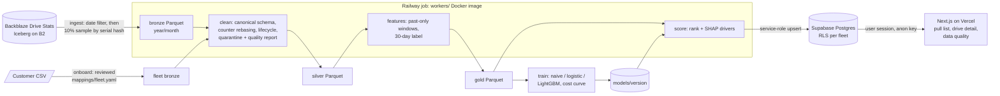
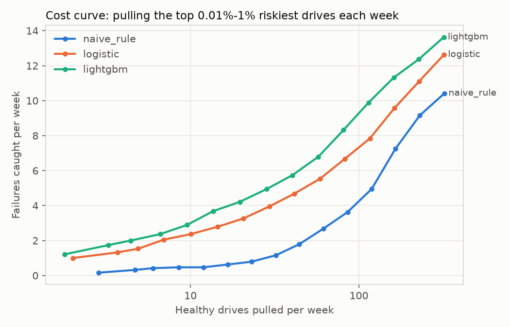

# Halflife

Storage operators lose data and on-call hours when hard drives die without warning, but pulling drives "just in case" wastes hardware and technician time. Halflife ranks every drive in a fleet by its risk of failing in the next 30 days, so an operator with capacity to replace K drives a week pulls the right K. It explains each pick in plain language and shows exactly how messy the incoming sensor data was.

Data: [Backblaze Drive Stats](https://www.backblaze.com/cloud-storage/resources/hard-drive-test-data) (daily SMART snapshots), read from Backblaze's public Iceberg table on B2. Halflife is not affiliated with Backblaze.

## Architecture



A Railway cron runs `halflife nightly` every day: it picks up any newly published Backblaze data, rescores the fleet and raises alerts when a drive enters the weekly pull list or jumps 100+ ranks toward it (shown on an Alerts page, and posted to Slack when a webhook is set). Python workers (uv, DuckDB, Polars, LightGBM, Typer) do the data work; only curated outputs (scores, 180-day history for the top 1,000 drives, quality reports) reach Supabase. The web app reads with the signed-in user's session, so Postgres row-level security decides what each fleet sees.

## Messy-data fixes (latest full run)

2024-01-01 to 2025-12-31, 10% of drives sampled by serial-number hash (each sampled drive keeps its full history):

| Check | Count |
|---|---|
| Rows in (bronze) | 22,490,291 |
| Rows out (silver) | 22,485,165 |
| Quarantined: capacity reported as ≤ 0 | 3,312 |
| Quarantined: rows after a drive's first failure (drive "failed" then reappeared) | 1,814 |
| SMART counter resets rebased (counter dropped within a drive) | 2,458 events, 265,089 rows adjusted |
| Distinct schema hashes (set of reported SMART columns changed by month) | 5 |
| Drives: still active / retired or missing / failed | 34,147 / 2,687 / 860 |

Rows in always equals rows out plus quarantined, and every quarantined row keeps a reason. A run fails if any column's null rate jumps more than `NULL_RATE_MAX_JUMP` against the previous report. Onboarding the synthetic "Northwind" customer file (renamed columns, Fahrenheit temperatures, MM/DD/YYYY dates, numbers with thousands separators, two SMART columns missing) quarantined 712 duplicates (2%) and scored 300 drives at 77% attribute coverage, from a column mapping proposed automatically and saved to [mappings/northwind.yaml](mappings/northwind.yaml).

Which SMART attributes are used and why: [docs/decisions/0001-smart-attributes.md](docs/decisions/0001-smart-attributes.md).

## Model results

Label: the drive fails within 30 days. Splits by date with 30-day gaps: train 2024-01-01 to 2025-01-19, validate 2025-02-19 to 2025-06-26, test 2025-07-27 to 2025-12-01. Evaluated on weekly (Monday) snapshots of ~34k drives; K = 50 drives pulled per week. LightGBM was picked on validation PR-AUC.

| Test period | PR-AUC | Precision@50 | Recall@50 |
|---|---|---|---|
| Naive rule (reallocated or pending sectors > 0) | 0.021 | 3.8% | 5.9% |
| Logistic regression | 0.061 | 10.1% | 15.6% |
| **LightGBM** | **0.078** | **11.7%** | **18.1%** |

At 50 pulls a week, LightGBM catches about 3x as many soon-to-fail drives as the naive rule. Failures are rare (~0.1% of drives fail in any 30 days), so even the best model pulls mostly healthy drives at this K; the cost curve shows the trade-off for each weekly pull budget (top 0.01% to 1% of the fleet):



Risk is a ranking score, not a calibrated probability (training downsamples healthy rows and uses class weights). Full tables: [docs/evaluation.md](docs/evaluation.md).

## Run locally

Requires uv, Node 22, Docker and the Supabase CLI.

```sh
make setup
cp .env.example .env        # fill B2_* with the public read-only values from Backblaze's Iceberg post
supabase start              # local Postgres + Auth; applies the migration and seed
# put `supabase status` API URL + service_role key into .env (SUPABASE_*)
# and API URL + anon key + DEMO_PASSWORD into web/.env.local (NEXT_PUBLIC_*)

cd workers
uv run --env-file ../.env halflife ingest --start 2024-01-01 --end 2025-12-31 --sample-pct 10   # ~10 min, also writes the 1% fixture
uv run halflife clean
uv run halflife features
uv run halflife train        # optional: a trained model is committed in models/
uv run --env-file ../.env halflife score --date 2025-12-31
uv run --env-file ../.env halflife nightly     # what the daily job runs: ingest new months -> clean -> features -> score newest day -> alerts

uv run python ../scripts/make_northwind.py
uv run halflife onboard --fleet Northwind --file ../data/northwind/northwind.csv           # writes mappings/northwind.yaml
uv run --env-file ../.env halflife onboard --fleet Northwind --file ../data/northwind/northwind.csv --apply

cd ../web && npm run dev     # http://localhost:3000, use "Demo: Acme Storage"
```

For fast iteration, point any step at the 1% fixture: `DATA_DIR=workers/tests/fixtures/onepct`. Checks: `make lint`, `make test` (Python unit tests, including a leakage test), `make test-db` (RLS isolation test).

## Next

- Survival model (time-to-failure) instead of a fixed 30-day label, and probability calibration.
- Upload UI for customer files, with the mapping review in the browser.
- Drift monitoring on feature distributions and model precision over time.
- Email alerts (Slack and the in-app Alerts page exist today).
