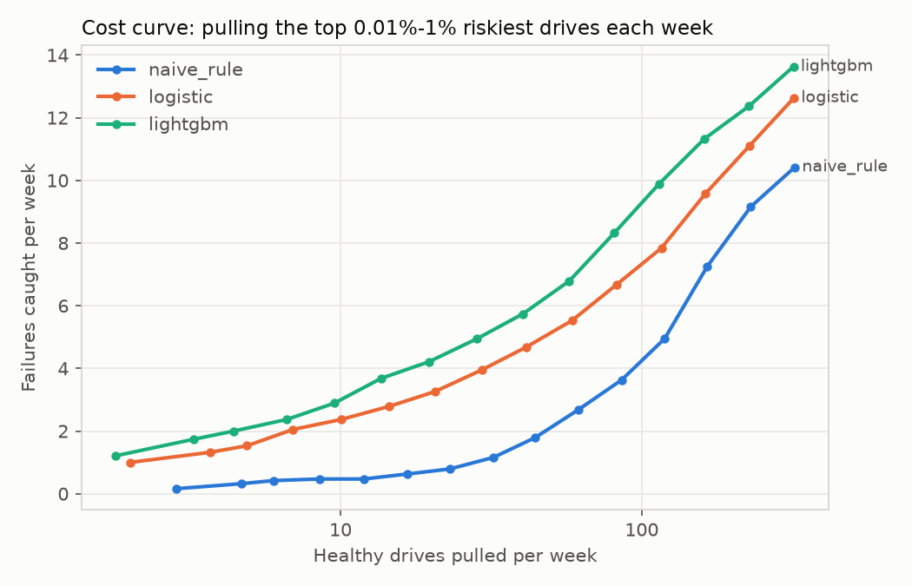

# Evaluation — model 20261104-1138

Best (by validation PR-AUC): **lightgbm**. K = 50 drives per weekly snapshot. Splits: {'train': ['2024-01-01', '2025-01-19'], 'validate': ['2025-02-19', '2025-06-26'], 'test': ['2025-07-27', '2025-12-01']}.

### Validate

| model | pr_auc | precision_at_50 | recall_at_50 |
|---|---|---|---|
| naive_rule | 0.0503 | 0.0811 | 0.1157 |
| logistic | 0.1126 | 0.1667 | 0.2377 |
| lightgbm | 0.1413 | 0.1844 | 0.2631 |

### Test

| model | pr_auc | precision_at_50 | recall_at_50 |
|---|---|---|---|
| naive_rule | 0.0212 | 0.0379 | 0.0585 |
| logistic | 0.061 | 0.1011 | 0.1561 |
| lightgbm | 0.0781 | 0.1168 | 0.1805 |

